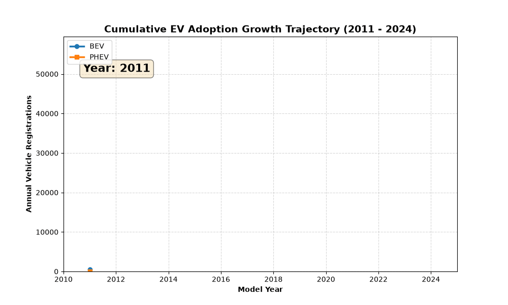
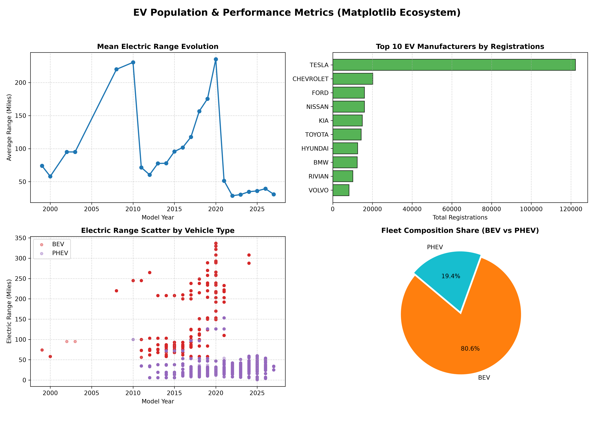
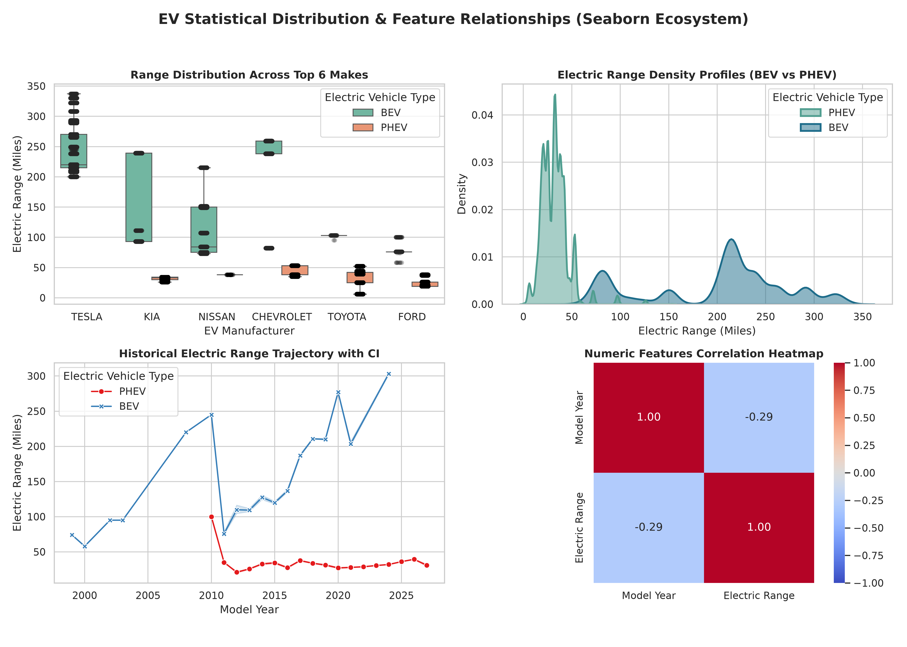
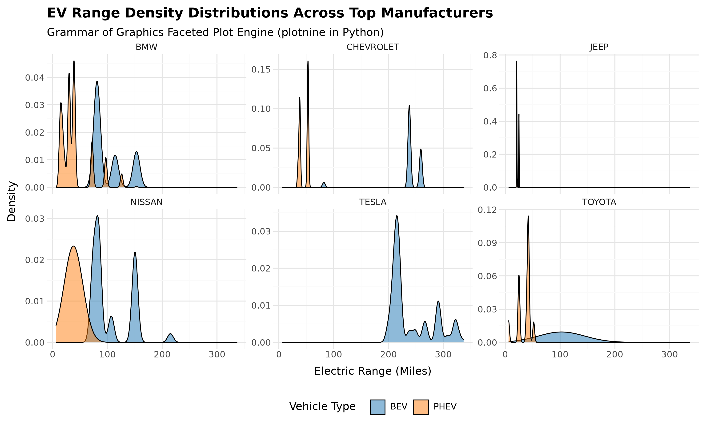
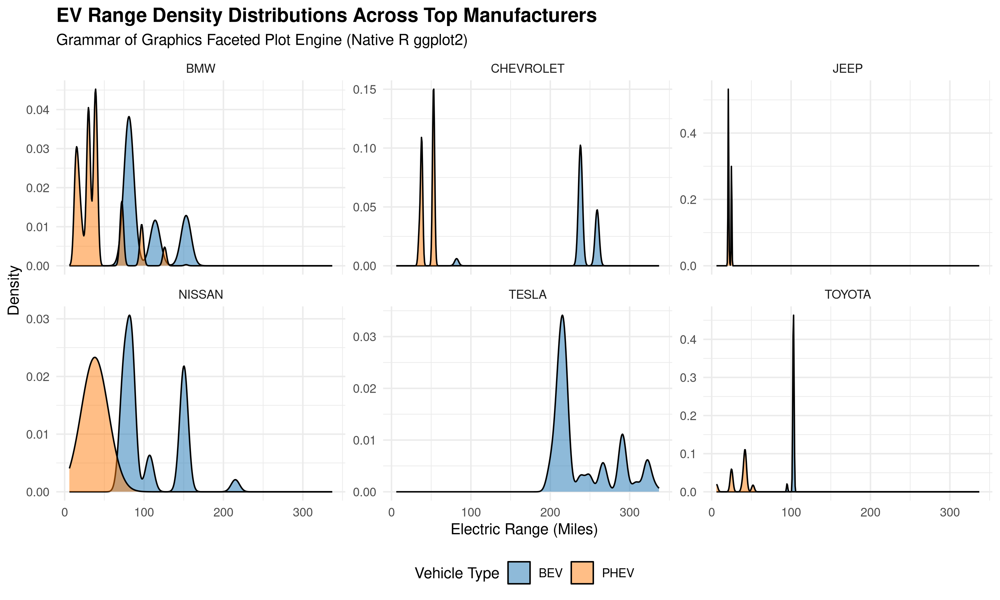

# EV Transition Analytics Suite: Visual Paradigm Benchmark

---

### **Student & Course Details**
* **Student Name:** MUHSIN KALODI
* **Roll Number:** 26MTAIDPY0021
* **Department:** Department of Computer Science
* **Program:** M.Tech in Artificial Intelligence & Data Science
* **Course:** Business Analytics 
* **Assignment Title:** Comparative Paradigm Study of Visualization Engines (Matplotlib, Seaborn, plotnine, ggplot2)

---

## Executive Summary & Dataset Overview

This project presents a comparative technical benchmark of four data visualization paradigms—ranging from imperative plotting to declarative Grammars of Graphics—across Python and R. The benchmark measures lines of code (LOC), execution runtime, asset file size, and visual clarity using a real-world enterprise dataset.

### Dataset Information & Online Source
- **Dataset Name:** Electric Vehicle Population Data
- **Data Provider:** Washington State Department of Licensing (DOL) via Data.gov
- **Access Link:** [Download Official Dataset (Data.gov Direct CSV)](https://data.wa.gov/api/views/f6w7-q2d2/rows.csv?accessType=DOWNLOAD)
- **Landing Page & Data Dictionary:** [Data.WA.gov Portal Page](https://data.wa.gov/Transportation/Electric-Vehicle-Population-Data/f6w7-q2d2)

### Dataset Description & Hygiene
The raw dataset contains over 150,000 individual registration records of Battery Electric Vehicles (BEVs) and Plug-in Hybrid Electric Vehicles (PHEVs). For this study, data ingestion pipelines extract and sanitize key analytical features:
1. **Model Year:** Manufacturing year of the vehicle.
2. **Make & Model:** Vehicle manufacturer (e.g., TESLA, NISSAN, FORD) and model name.
3. **Electric Vehicle Type:** Categorized into **BEV** (Battery Electric Vehicle) and **PHEV** (Plug-in Hybrid Electric Vehicle).
4. **Electric Range:** Maximum range in miles achievable on zero-emissions electric power.
5. **County:** Regional registration jurisdiction within Washington State.

---

## Project Repository Architecture

ev-transition-analytics-suite/
├── .github/
│   └── workflows/
│       └── ci_pipeline.yml          # GitHub Actions CI automated build pipeline
├── data/
│   ├── raw/
│   │   └── .gitkeep                 # Raw dataset cache folder (CSVs ignored by .gitignore)
│   └── processed/
│       └── .gitkeep                 # Cleaned dataset output folder
├── python/
│   ├── init.py
│   ├── data_loader.py               # Data ingestion & feature selection script
│   ├── matplotlib_analytics.py      # Imperative multi-panel grid plotting script
│   ├── seaborn_analytics.py         # Statistical KDE & boxplot distribution script
│   └── plotnine_analytics.py        # Python Grammar of Graphics (plotnine) pipeline
├── r/
│   ├── data_loader.R                # (Optional) Native R data ingestion pipeline
│   └── ggplot2_analytics.R          # R Grammar of Graphics (ggplot2) pipeline
├── benchmarks/
│   ├── performance_benchmark.py     # Execution time, LOC, & file-size benchmark collector
│   ├── generate_animation.py        # Dynamic EV adoption GIF generator script
│   └── benchmark_results.json       # Exported metric records
├── assets/                          # Generated 300 DPI high-resolution figures & GIF
├── requirements.txt                 # Python virtual environment dependencies
├── .gitignore                       # Git ignore configuration (includes datasets)
├── LICENSE                          # MIT License
└── README.md                        # Documentation & assignment report

---

## Visual Deliverables & Output Showcase

### 1. Dynamic Adoption Trajectory (Matplotlib Engine)


### 2. Multi-Panel Imperative Dashboard (Matplotlib)


### 3. Statistical Distribution & Density Profiles (Seaborn)


### 4. Grammar of Graphics Faceted Density Comparison

| Python Engine (`plotnine`) | R Engine (`ggplot2`) |
| :---: | :---: |
|  |  |

---

## Comparative Benchmark & Performance Matrix

The following benchmark metrics were collected systematically across all 4 rendering engines using `benchmarks/performance_benchmark.py`:

| Framework | Paradigm / Implementation | Lines of Code (LOC) | Rendering Time (s) | Asset Size (KB) |
| :--- | :--- | :---: | :---: | :---: |
| **Matplotlib** | Python (Imperative) | ~87 | ~27.7s | ~457 KB |
| **Seaborn** | Python (Statistical) | ~112 | ~1.5s | ~586 KB |
| **plotnine** | Python (Grammar of Graphics) | ~67 | ~79.4s | ~296 KB |
| **ggplot2** | R (Grammar of Graphics) | **~45** | **~17.1s** | **~252 KB** |

---

## Critical Analytical Insights

1. **Brevity & Expressiveness:** R's `ggplot2` requires the fewest lines of code (**45 LOC**) to render complex faceted density profiles due to its native integration with functional data manipulation (`dplyr`).
2. **Computational Velocity:** R `ggplot2` compiles complex faceted plots significantly faster (**~17.1s**) than Python `plotnine` (**~79.4s**) because of lower-level C/C++ graphics bindings.
3. **Statistical Workflows:** `Seaborn` minimizes boilerplate code for statistical visualizations, offering fast rendering for boxplots and kernel density estimates (**~1.5s**).
4. **Custom Canvas Control:** `Matplotlib` remains essential when full control over individual plot canvas grid locations or custom frame-by-frame animations (`FuncAnimation`) is required.

---

## Quickstart & Execution Instructions

### 1. Clone Repository & Setup Virtual Environment
```bash
git clone [https://github.com/muhsikalodi/ba_assinment.git](https://github.com/muhsinkalodi/ba_assignment.git)
cd ev-transition-analytics-suite

python3 -m venv venv
source venv/bin/activate
pip install -r requirements.txt